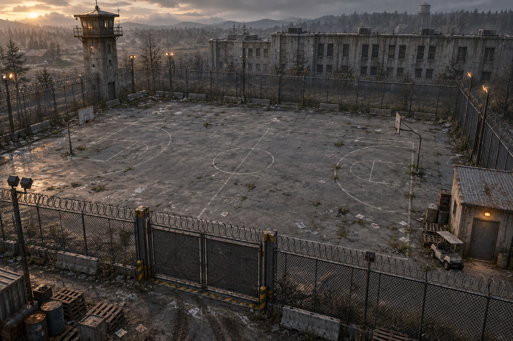

# DAYS GONE QUIET
### Two minds. One unforgiving world.

**UNITY · REINFORCEMENT LEARNING · SURVIVAL**

[**Enter Days Gone Quiet ↗**](https://aegis-sentinel-6u5m.onrender.com/#environment) &nbsp; · &nbsp; [**Training records ↗**](https://aegis-sentinel-6u5m.onrender.com/#runs) &nbsp; · &nbsp; [**Survival controls ↗**](Assets/Survival/README.md)

*Grayhaven Prison Yard concept art. The atmosphere we are building toward, not an in-engine screenshot.*

---

## The world pushes back

This started with one little arena, one Rick, and one Walker.

Now Rick is learning inside **Grayhaven Prison Yard**: chain-link fences, guard towers, cracked concrete, dead weeds, and a road leading toward whatever comes next.

The prison has an inside. The doors do not always hold. And Rick has company: **Negan, Lucille, and a second brain with a lot to learn.**

Days Gone Quiet is an independent Unity reinforcement-learning project. The world supplies the obstacles. The agents observe, act, receive rewards, and try again.

**The simulation is fictional. The learning is real.**

## Something beyond the walls

The prison is not the whole story.

Days Gone Quiet sits within **Project Sentinel**, a research initiative under **[AEGIS Dynamics](https://aegis-sentinel-6u5m.onrender.com/)**. Here, the question is how to survive the next encounter. Somewhere above the experiment, the question is what those encounters teach.

[**Follow the signals to Sentinel Command ↗**](https://aegis-sentinel-6u5m.onrender.com/#command)

PROJECT SENTINEL / EXPERIMENTAL ENVIRONMENT 001 / DAYS GONE QUIET

---

## Meet the learners

| Agent | Policy | Training objective |
| :--- | :--- | :--- |
| **Rick** | `RickEscape` | Survive and reach the prison interior when threatened outside. |
| **Negan** | `NeganCombat` | Learn movement and timed attacks, with rewards for damaging and defeating simulated Walkers. |

Two independent PPO policies. Separate rewards. The same unforgiving world.

Coordinated teamwork is still a research question.

---

## Learning through trial and error

Rick is not simply told:

> “If the Walker gets close, run away.”

He observes where he is and where the Walker is, chooses how to move, and learns from what happens next.

In the original yard-only experiment:

- surviving earns a reward
- getting caught earns a penalty
- leaving the yard earns a penalty
- every episode resets Rick and the Walker
- Rick tries again

And again.

And again.

Some attempts look promising.

Some look like Rick completely forgot what a Walker is. 😅

That is part of the experiment.

We can train Rick, Negan, or both at once. Sharing the prison is the beginning; learning to coordinate is the next frontier.

---

## Inside Grayhaven

The prison entrance now leads somewhere.

Inside is a roofed, two-floor cellblock with twelve cells, stairs, an upper gallery, bunks, a common room, supplies, pipes, and fluorescent lights. You can walk in from the yard and explore it yourself.

The world has a few more ways to push back, too:

- **Doors have consequences.** The prison entrance, Cell 104, and dark hallway doors can open and close. They block movement, refuse to close on a character, and can be battered open by Walkers.
- **Walkers can find their way around.** Navigation connects the yard and interior, with active Walkers in the yard, cells, and hallway.
- **Lucille is more than a prop.** Negan has a timed wind-up, strike, follow-through, and recovery. Range, facing, and a clear path to the target decide whether a swing lands.
- **The atmosphere keeps growing.** Four restrained Walkers struggle beside the entrance. They are visual scenery for now; release and combat behavior are future work.

Negan's character art was generated with Codex's image generation tool, while Lucille is separate animated geometry in Unity. The [art prompt](Assets/Survival/Negan-art-prompt.txt) is included with the project.

---

<strong>Inside the tools: Rick’s Learning Lab</strong>

One of my favorite additions to the original yard experiment is **Rick’s Learning Lab** inside Unity.

My partner and I can change things like:

- Rick’s speed
- the Walker’s speed
- rewards and penalties
- how close the Walker can spawn
- how long each episode lasts
- how often Rick makes a decision
- how fast training runs

That lets us change one thing at a time and see whether it helps or hurts Rick’s learning.

The Learning Lab also has a button that opens the **Days Gone Quiet training dashboard**, where we can watch Rick’s rewards and progress in TensorBoard.

---

## World Control

The new survival scene has its own dockable **World Control** panel.

Open **Days Gone Quiet → World Control** to:

- follow Rick, Negan, or both
- see health, kills, and whether each survivor is using a trainer, a saved brain, or a scripted preview
- change the training focus, round length, simulation speed, and Walker difficulty
- operate doors, pause, resume, or reset the round
- assign compatible saved brains and access trainer/dashboard commands

There is also a manual exploration mode: **T** to enter or leave, **WASD/arrows** to walk, **Shift** to run, and **E** to use a nearby door. The simulation pauses while we look around, then restores its previous state. Manual exploration is unavailable while a trainer is connected.

Sometimes we need to stop watching the experiment and walk through the place we built. 😅

See [the survival controls](Assets/Survival/README.md) for more detail.

---

## Enter the simulation

1. Clone this repository and add its project folder in **Unity Hub**.
2. Use the editor version in [ProjectVersion.txt](ProjectSettings/ProjectVersion.txt), currently **6000.6.2f1**.
3. Open `Assets/Scenes/PrisonYard.unity`.
4. Open **Days Gone Quiet → World Control** and choose a trainer, compatible saved brain, or scripted preview.
5. Press **Play**.

| Mode | What you are watching |
| :--- | :--- |
| **Connected trainer** | New learning through the Python ML-Agents trainer. Connect it before pressing Play. |
| **Saved brain** | Inference from a compatible ONNX export; no new training. |
| **Scripted preview** | A demonstration of the mechanics, not evidence of learned behavior. |

The camera has eight views:

1. Full Yard
2. Front Gate
3. Courtyard
4. Guard Tower
5. Follow Rick
6. Enclosed Cellblock
7. Restrained Walkers
8. Cellblock Cutaway

Press **1–8** while the game is running to switch between them. World Control also offers smooth Rick, Negan, and shared focus views. The manual-tour camera checks for walls and stays beneath the roof; the cutaway is there when we want to inspect the layout.

To see the learning charts, use the dashboard controls in **World Control** or **Days Gone Quiet → Open Training Dashboard**. TensorBoard needs to be running to display the records.

> **Tiny but important:** Pressing Play alone does not train a brain. Connect the Python ML-Agents trainer before pressing Play to learn, assign a compatible saved brain to watch inference, or enable **Scripted preview** to demonstrate the mechanics.

Earlier `RickEscape` and `NeganCombat` model snapshots are included in `Assets/Survival/Models/prison-duo-v1`. They are unassigned in the saved scene, and scripted preview starts off, so the learners are idle without a connected trainer or an assigned model. The old yard-only Rick brain uses a different input/action layout and belongs to the original experiment.

A saved brain is a milestone. It is not proof that Rick can reliably escape or Negan can reliably fight. We still have to watch, measure, and test.

Resuming PPO training also needs the original checkpoints, which remain outside this repository. The included ONNX files are for running saved policies.

---

## Reading the signals

The public **[Sentinel Command dashboard](https://aegis-sentinel-6u5m.onrender.com/#runs)** presents a reviewed snapshot exported **October 9, 2026**: **3 selected runs, 6 policy records, and 938 original reward samples**.

It is a snapshot, not a live training feed. Some records come from local experiments beyond the model exports committed here; exact source revisions for those runs were not recorded. The [source manifest](https://github.com/dane-anderson/aegis-sentinel/blob/main/public/data/research.json) records file hashes and limitations.

**Reward is not a success percentage.** Rick and Negan have different objectives. Reliable escape, combat performance, cooperation, and transfer need direct evaluation across repeated scenarios.

<strong>Local TensorBoard commentary workflow</strong>

Charts tell us a lot. Sometimes we also want someone to explain what changed in plain English.

Our local Codex workflow reviews the original training records after a session ends and saving finishes. It writes one rundown for Rick and Negan in TensorBoard's **Text** tab, under **01 Training commentary**, and keeps a separate report with its evidence.

The rundown separates reaching the training target from stopping early, describes each brain's recorded reward trends, and spells out what the logs cannot tell us. The original charts, logs, and checkpoints stay untouched.

This is a companion workflow in our local Codex workspace; its launcher and reporting tools are not included in this Unity repository.

---

## The experiment so far

The world and training foundation are in place. The next step is to measure what the agents can reliably do.

Current progress:

- [x] Rick is a working reinforcement learning agent
- [x] Walker chase behavior is working
- [x] collisions and episode resets are working
- [x] real PPO training is working
- [x] first trained Rick brain added
- [x] first visual pass for Rick and the Walker
- [x] Grayhaven Prison Yard built
- [x] prison buildings, fences, guard towers, vegetation, and yard details added
- [x] eight camera views, survivor focus, and manual exploration added
- [x] Rick’s Learning Lab added
- [x] TensorBoard dashboard launcher added inside Unity
- [x] connected, roofed prison interior with an upper gallery added
- [x] Negan and Lucille added, with timed swings, damage, and kills
- [x] separate RickEscape and NeganCombat training policies added
- [x] multiple active Walkers and breakable doors added
- [x] World Control panel added
- [x] earlier saved model snapshots included for evaluation
- [x] public AEGIS research site and Sentinel Command snapshot published
- [ ] keep experimenting with rewards and difficulty
- [ ] teach Rick to reliably survive one Walker
- [ ] evaluate escape and combat success directly
- [ ] teach Rick and Negan to cooperate
- [ ] add hiding, noise, stamina, supplies, and safe areas
- [ ] improve the characters and animation
- [ ] build roads leading toward other towns
- [ ] make the world bigger, stranger, and more dangerous

---

## Built with

- **Unity 6 + C#** — the world, gameplay, and custom editor tools
- **Universal Render Pipeline (URP)** — rendering the prison environment
- **Unity AI Navigation / NavMesh** — walkable routes, Walker pathfinding, and door obstacles
- **Unity Input System** — camera shortcuts and manual exploration controls
- **Unity ML-Agents** — observations, actions, rewards, and the connection to training
- **Python + PyTorch** — the training side of the experiment
- **PPO reinforcement learning** — independent RickEscape and NeganCombat policies
- **ONNX + Unity Inference Engine** — importing and running compatible saved brains
- **TensorBoard** — training charts and the local commentary workflow's Text reports

Custom Unity validation tools check the connected routes, doors, combat, camera behavior, and round resets. They help verify the mechanics; evaluating learned behavior is a separate part of the experiment.

---

## Beyond the prison

The dream is a larger survival world where learning agents have to deal with Walkers, obstacles, resources, other survivors, and choices that become more complicated over time.

The prison yard is the first real location.

Later there can be roads.

Then towns.

Then more kinds of trouble.

Then we see what Rick and Negan actually learned.

For now:

**One Rick. 
One Negan. 
A prison full of Walkers. 
Two neural networks with a lot to learn.**

🧟‍♂️

---

**Beyond the walls, the experiment continues.**

[Days Gone Quiet](https://aegis-sentinel-6u5m.onrender.com/#environment) &nbsp; · &nbsp; [Project Sentinel](https://aegis-sentinel-6u5m.onrender.com/#program) &nbsp; · &nbsp; [AEGIS Dynamics](https://aegis-sentinel-6u5m.onrender.com/)

*Days Gone Quiet is an independent learning project inspired by zombie-survival stories. AEGIS is the fictional parent organization in the project's narrative; Athena is its fictional Chief Intelligence Officer. Research claims remain tied to recorded evidence.*

